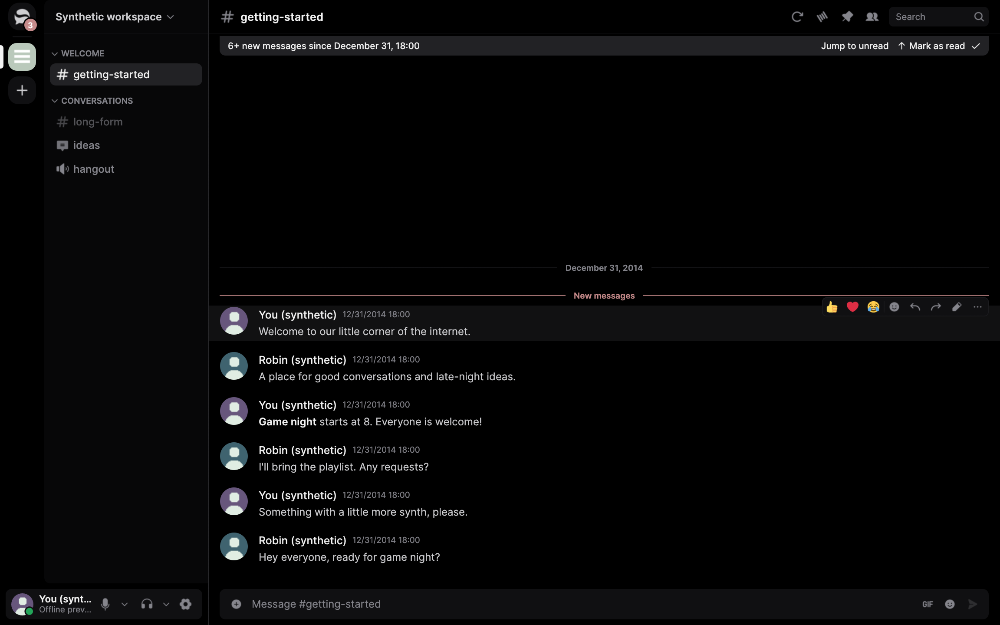

<p align="center">
  
</p>

<h1 align="center">Strafe</h1>

<p align="center">
  A native, GPU-accelerated Discord client written in Rust — built for a smooth, quiet,
  full-black desktop experience.
</p>

<p align="center">
  
</p>

## Why Strafe

Strafe is a personal fork of [Serein](https://github.com/ViceVerse-cz/Serein). It talks to your
existing Discord account through Discord's gateway and REST API, and renders everything with
`egui`/`wgpu` instead of an embedded browser.

- One native process instead of a Chromium app with helper processes
- Around **33 MB** idle and near-zero idle CPU on Linux
- Full-black **Strafe Black** theme with minimal colour
- macOS-style traffic lights on Linux, and a compact title strip on every screen
- Voice, screen share, camera, themes and extensions inherited from Serein

## Build

```sh
sudo apt install libwebkitgtk-6.0-dev libgtk-4-dev libgstreamer1.0-dev \
  libgstreamer-plugins-base1.0-dev libpulse-dev libasound2-dev cmake clang \
  libxkbcommon-dev libwayland-dev libx11-xcb-dev libvulkan-dev libfreetype-dev \
  libfontconfig1-dev pkg-config

cargo build --release
```

Then install it into your user profile:

```sh
./install.sh
```

The launcher uses `~/.local/bin/strafe`, so the checkout can be cleaned afterwards.
`./uninstall.sh` removes the binary, launcher and icons but keeps your data.

Data lives in `~/.local/share/strafe-development` while running from a source build. Set
`STRAFE_DATA_DIR` to use an isolated profile.

## Fork notes

- App ID, package, binary, data directory, icons and user-facing text are Strafe.
- The default theme is `extensions/themes/strafe.serein-extension`.
- Upstream auto-updates are disabled so Strafe never replaces itself with a Serein build.
- See [STRAFE.md](STRAFE.md) for the fork-specific details and upstream sync workflow.

## Unofficial client

Strafe is unofficial and not endorsed by Discord. Automating a normal account outside Discord's
OAuth2/bot API violates Discord's Terms of Service and carries a risk of account termination.
Use it for your own account and do not monetise or automate it.

## License

MIT OR Apache-2.0, inherited from Serein. See `LICENSE-MIT`, `LICENSE-APACHE` and
`THIRD_PARTY_NOTICES.md`.
